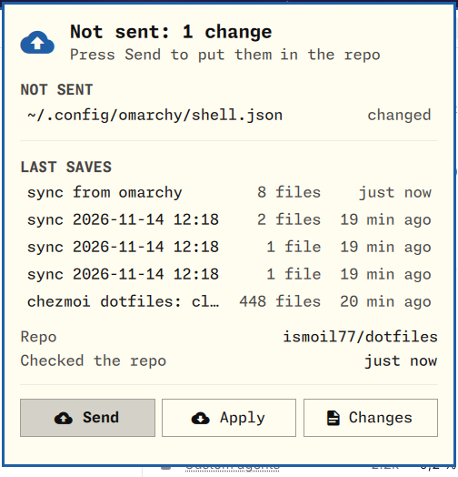

# Dotfiles — chezmoi sync for the Omarchy bar

[Русский](README.ru.md)

Shows in the bar whether your [chezmoi](https://www.chezmoi.io) dotfiles are in step with their repo:

- **↑3**: this machine has 3 changes that are not in the repo yet
- **↓2**: the repo has 2 saves from another machine that are not applied here
- nothing: all is saved



The popup lists the files, the incoming saves, the last saves and when the repo was checked. Three
buttons run in a floating terminal, so chezmoi can still ask you things:

| Button | Key | What it runs |
|---|---|---|
| Send | `s` | re-adds the files edited here (`chezmoi re-add -- <those files>`), adds new files in watched folders, commits `sync from <host>`, rebases on the other machine's saves if needed, pushes |
| Apply | `a` | `chezmoi update` (pull and apply) |
| Changes | `d` | your edits (`chezmoi diff --reverse`), then what came from the repo |

`Enter` runs the stressed button, `r` checks again, a click on a file row shows its change. Right
click on the bar icon checks again.

## Install

```bash
omarchy plugin add https://github.com/ismoil77/omarchy-dotfiles.git --enable
```

(or copy the folder to `~/.config/omarchy/plugins/ismoil.dotfiles/`, run
`omarchy-shell shell rescanPlugins`, then `omarchy plugin enable ismoil.dotfiles`).

Plugins run unsandboxed inside the shell — read the code first; it is small. The widget only reads
(`chezmoi status`, `chezmoi unmanaged`, `git fetch`/`log`); it writes nothing until you press a
button, and every button runs in a terminal you can see. Update with `omarchy plugin update ismoil.dotfiles`.

## Remove

```bash
omarchy plugin remove ismoil.dotfiles
```

Nothing else is left behind: the widget keeps no cache. Your chezmoi setup and repo are untouched.

## Needs

- `chezmoi` with a source repo that has a remote (`chezmoi init`, `git remote add origin …`)
- `git`, `python3`; **install `gitleaks`**: Send then scans the whole repo before every commit and
  stops on a found secret. Without it, only new files are checked (see below) and Send says so.

## New files in folders

`chezmoi status` sees edits to files it manages, not new files. List the folders where a new file
should count as "not sent" (skills, commands, notes) in your chezmoi data, for example
`~/.local/share/chezmoi/.chezmoidata/dotfiles.toml`:

```toml
[dotfiles]
watch = ["~/.claude/skills", "~/.claude/commands"]
```

Send adds those new files with `chezmoi add --secrets=error`, so a new file that looks like a secret
is refused and nothing is sent (chezmoi itself only warns by default). Edits to files already in the
repo are checked by gitleaks only. A name with a newline or another control character is never
added: chezmoi 2.74 would split it into other paths. Every new path must lie inside a watched folder. For new and edited files alike, every folder on the
way (and inside a new folder) must be yours alone — not writable by group or others, not a link — or
the file is skipped with a message.

## Settings

| Setting | Default | |
|---|---|---|
| `fetchMinutes` | 10 | how often `git fetch` asks the repo; opening the popup asks too |
| `interval` | 120 | how often (seconds, at least 30) `chezmoi status` checks this machine; no network |
| `language` | auto | `en`, `ru`, or the system locale |
| `textSize` | Normal | Normal, Large, Extra large |
| `animations` | true | |
| `chezmoi` | empty | path to the binary when it is not on PATH |

IPC: `omarchy-shell ismoil.dotfiles toggle | refresh | send | apply`.

## Tests

```bash
tests/run.sh   # Python: parsers, and Send/Apply between two sandbox machines with real chezmoi and git
               # Node: texts and logic; Qt: the libraries in Qt's engine; omarchy plugin validate
```

## License

MIT
