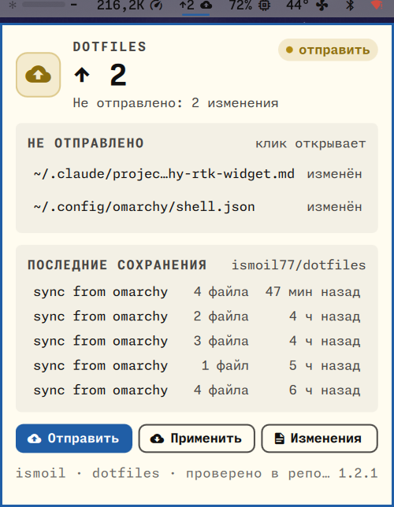

# Dotfiles — синк chezmoi в баре Omarchy

[English](README.md)

Показывает в баре, совпадают ли твои конфиги [chezmoi](https://www.chezmoi.io) с репо:

- **↑3**: на этом компе 3 изменения, которых ещё нет в репо
- **↓2**: в репо 2 сохранения с другого компа, здесь они ещё не применены
- пусто: всё сохранено



В окне видно файлы, что пришло, последние сохранения и когда проверялся репо. Три кнопки
открывают терминал, чтобы chezmoi мог задать вопрос:

| Кнопка | Клавиша | Что делает |
|---|---|---|
| Отправить | `s` | `chezmoi re-add`, добавляет новые файлы из папок слежения, коммит `sync from <комп>`, если надо, ставит поверх сохранений с другого компа, push |
| Применить | `a` | `chezmoi update` (скачать и применить) |
| Изменения | `d` | твои правки (`chezmoi diff --reverse`), потом то, что пришло из репо |

`Enter` жмёт выделенную кнопку, `r` проверяет снова, клик по файлу показывает его изменение.

## Установка

```bash
omarchy plugin add https://github.com/ismoil77/omarchy-dotfiles.git --enable
```

## Первый запуск

Команда выше и есть вся установка. Если chezmoi ещё нет или репо не подключён, окно показывает шаг
и кнопку: «Установить chezmoi», потом «Подключить репо». Пока не нажмёшь «Применить», на компе
ничего не меняется.

## Удаление

```bash
omarchy plugin remove ismoil.dotfiles
```

Виджет ничего не оставляет после себя, chezmoi и репо не трогает.

## Новые файлы в папках

chezmoi видит правки в своих файлах, но не новые файлы. Папки, где новый файл = «не отправлено»,
пишутся в данные chezmoi, например `~/.local/share/chezmoi/.chezmoidata/dotfiles.toml`:

```toml
[dotfiles]
watch = ["~/.claude/skills", "~/.claude/commands"]
```

## Секреты

Поставь `gitleaks`: тогда «Отправить» проверяет весь репо перед каждым коммитом и останавливается на
найденном секрете. Без него проверяются только новые файлы (`chezmoi add --secrets=error`), и
«Отправить» об этом предупреждает. Файлы с переводом строки в имени не добавляются никогда.

## Лицензия

MIT
